# HarmonyOS待办清单应用的设计与实现

> 提交版正文同步日期：2026年11月27日。Word沿用学校模板；本Markdown与Word正文同步维护。正文覆盖新版示例任务页与116项检查，图3、图5、图6保留改版前画面，新版运行截图待补。教师评阅栏不在内容稿中填写。

——基于ArkTS的任务管理与智能规划

学    生：向骞

（人工智能学院，计科24-3，学号202440210325）

摘  要：本文介绍HarmonyOS待办清单TodoApp的设计与实现。应用支持任务新增、编辑、完成切换、搜索筛选、截止时间、软删除与恢复，使用ArkUI容器和TodoItem自定义组件组织界面，以状态管理V2驱动数据变化，通过Navigation管理多页跳转。示例任务页使用NetworkKit请求公开测试接口，将完成数量绑定到原生DataPanel圆环，并将课堂场景与代理配置收进折叠设置。DeepSeek扩展提供会话密钥、目标拆解、结果预览和确认后批量加入。2026年11月27日完成116项本地检查与HAP增量构建。正文按新版代码同步，运行图保留改版前时点；新版界面截图、真实在线鉴权等仍需专项复验。

关键词：HarmonyOS；ArkTS；待办清单；Navigation；DeepSeek

## 前言

### 项目背景

智能终端上的待办应用需要兼顾快速记录、持续整理和完成回顾。本项目以个人课程任务为对象，形成从记录到完成回看的使用流程：用户填写标题、描述、优先级和截止时间，在首页搜索、筛选并查看完成进度，误删任务可从回收站恢复。示例任务页以公开测试资源呈现远端待办，智能规划页将用户主动输入的目标转为待确认任务草稿。应用采用DevEco Studio 26.0.0、ArkTS及ArkUI开发，当前工程SDK配置为HarmonyOS API 26；个人任务、远端样本与规划草稿分别维护，网络请求不会替换个人列表。

### 研究现状

HarmonyOS开发资料介绍ArkUI声明式界面、状态管理V2、Navigation与NetworkKit HTTP接口[1-4]，分别支撑布局、共享状态、路由和远端请求。JSONPlaceholder提供公开todos测试资源[5]；DeepSeek文档介绍聊天补全、Bearer认证和JSON输出[6-7]。项目据此分别封装两类在线服务，对响应逐项校验，规划结果经用户确认后才写入本地任务库。

## 需求分析

### 用户角色与使用边界

系统面向单一普通用户，不设置管理员角色。用户从首页维护个人任务、筛选完成状态并恢复误删事项；示例任务页展示远端列表、请求状态与完成比例；DeepSeek智能规划页接收用户主动输入的学习目标，并在配置API Key后请求任务拆解。规划结果先预览，由用户确认后才写入个人待办。三个模块共用应用导航入口，个人任务、远端测试数据和智能规划草稿分别管理。

### 功能需求

个人任务模块支持新增、编辑、完成与取消完成、搜索筛选、优先级及截止时间显示、软删除与恢复，列表与统计同步更新。新增与编辑共用表单，标题为空时不保存，未保存返回时提示确认。示例任务模块实际发出HTTP请求，提供正常、空列表、错误及刷新重试场景，图表随远端样本变化。DeepSeek模块提供密码形式的密钥输入与清除、目标拆解请求、错误提示和结果确认；未配置密钥时可以运行明确标识的离线示例。

### 容错与验收要求

示例任务页须区分首次加载、请求失败、成功空结果和成功列表。失败时保留已有数据并标注来源，普通恢复返回正常列表；课堂场景与技术说明由用户展开后查看。数据层校验状态码、JSON结构与字段，并释放HTTP对象。验收重点包括页面往返、表单回填、列表计数与图表更新。本次检查源码及本地逻辑；留存运行图来自改版前的HarmonyOS模拟器，不证明新版界面已完成设备交互验收。

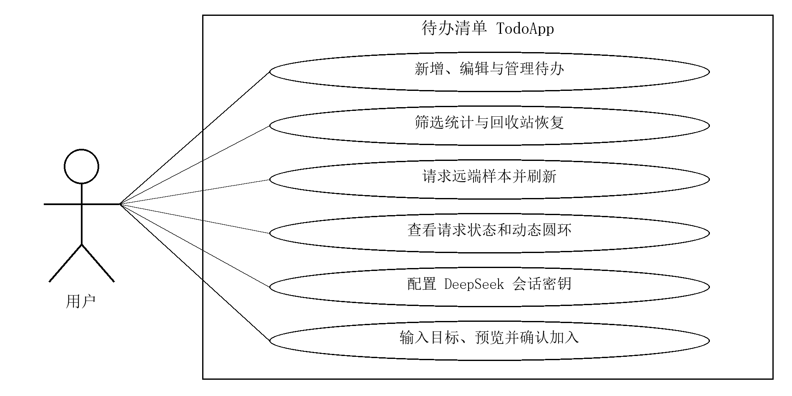

图1 TodoApp用户用例图

Fig. 1 User use cases of TodoApp

图1以普通用户为参与者，列出任务维护、筛选恢复、远端请求、动态圆环、会话密钥配置和规划确认六类用例。个人任务、网络演示和智能规划共用应用入口，各自维护操作状态；只有经用户确认的规划结果才写入个人任务库。

## 系统概要设计

### 系统功能结构设计

系统由个人待办首页、新增/编辑页、示例任务页和DeepSeek智能规划页组成。首页负责搜索、筛选、统计与模块入口；表单负责用户输入；网络页展示远端请求状态、样本列表和DataPanel；智能规划页负责配置密钥、输入目标及确认规划草稿。个人数据由TodoStore维护，远端样本由NetworkStore维护，DeepSeek的密钥、请求状态及任务建议由独立状态对象维护。ApiService与DeepSeekService分别封装两类HTTP请求，图2按三类业务模块展示页面、状态、服务与仓库的职责划分。

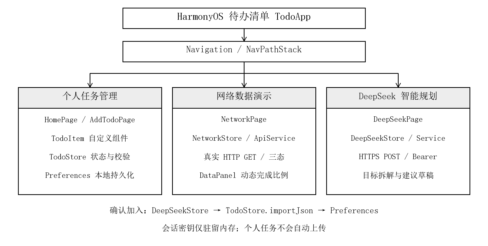

图2 TodoApp系统功能结构图

Fig. 2 Functional structure of TodoApp

图2中的网络页面通过NetworkStore和ApiService取得远端样本，个人任务通过TodoStore维护本地状态和持久化。DeepSeek扩展通过独立的DeepSeekStore与DeepSeekService管理配置和草稿，再复用TodoStore的批量导入入口提交确认后的任务。分离数据来源能够防止远端示例刷新或规划失败覆盖个人列表。

### 技术选型

页面采用ArkTS与ArkUI声明式组件，待办页、表单页、网络页和智能规划页按职责组织。模型与仓库使用@ObservedV2和@Trace，页面采用@ComponentV2与@Local，组件通过参数和事件通信；Navigation与NavPathStack管理页面栈。两类在线服务均采用@kit.NetworkKit的http接口，JSONPlaceholder使用GET读取远端待办，DeepSeek使用HTTPS POST与Bearer认证生成JSON任务草稿。正式Ability上下文中由Preferences保存个人任务；密钥独立留在进程内存，不随个人JSON保存。图表采用系统DataPanel。

## 系统详细设计

### 首页详细设计

#### 界面组成与交互

首页包含日期与操作入口、搜索框、完成进度、状态筛选、任务列表、统计区和回收站。Row、Column组织信息，Stack承载确认层，List与ListItem呈现TodoItem，Refresh处理刷新。点击完成区切换状态、文本区进入编辑，左滑删除；统计与筛选共用有效任务，排除回收站。新版入口为“示例任务”；图3保留改版前状态。

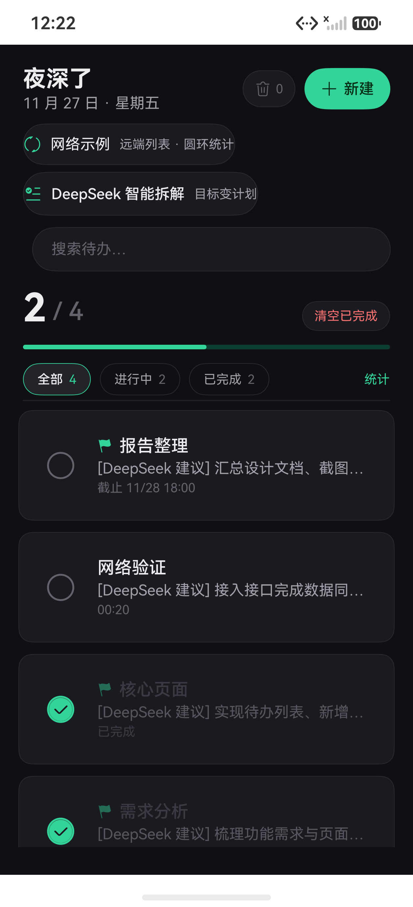

图3 模拟器首页完成状态与同步计数

Fig. 3 Home screen with synchronized completion counts

图3展示中文课程任务首页。进度为2/4，即50%，筛选项为全部4、进行中2、已完成2，与任务完成标记一致。“报告整理”设为重要，截止时间为11月28日18:00；“网络验证”处于进行中，“核心页面”和“需求分析”处于已完成状态。任务描述保留来源字段，计数和进度均由个人仓库中的有效任务计算。

#### 个人数据模型

Todo包含编号、标题、描述、完成状态、优先级、截止时间、软删除标记和完成时间。TodoStore统一校验与写入：先生成新对象和数组，Preferences同步保存成功后再更新页面状态；失败则保留原列表并提示。删除先进入回收站，恢复与彻底删除使用明确操作入口。

### 新增与编辑页面详细设计

#### 表单与路由参数

新增与编辑共用AddTodoPage，统一字段布局和校验规则。表单按标题、描述、截止时间和优先级组织输入区，底部放置保存按钮，并以滚动容器适应受限高度。图4展示编辑任务时的参数回填。首页新增入口将空参数入栈，编辑入口携带Todo对象；页面按编号读取仓库中的当前记录，保存成功后通过NavPathStack.pop返回首页，失败时留在表单中提示修正。

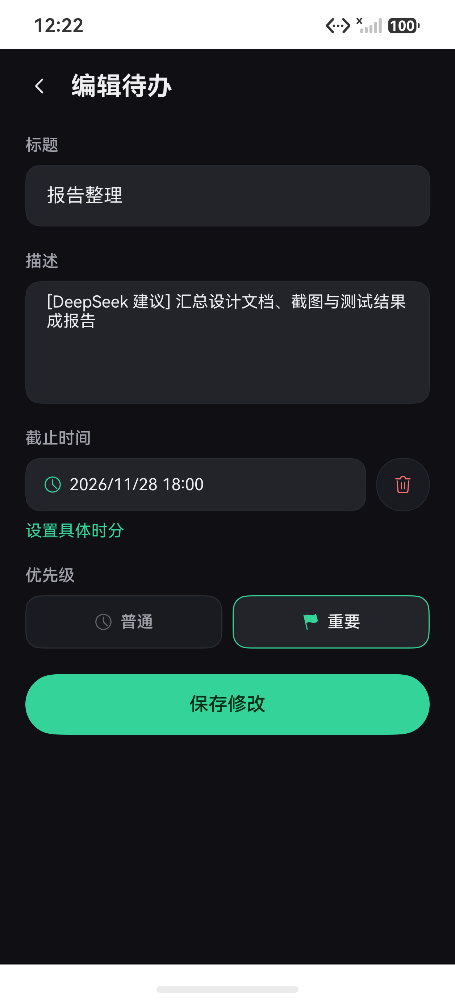

图4 编辑表单与任务参数回填

Fig. 4 Edit form with task parameters

图4回填“报告整理”的标题和描述，截止时间为2026/11/28 18:00，优先级为重要，底部显示“保存修改”。表单按记录编号读取当前任务，标题、描述、日期和优先级由同一入口提交。有效修改经仓库校验并保存后返回首页，失败则保留输入内容以便修正；截图中的回填值与首页对应任务一致。

### 示例任务页面详细设计

#### 请求接口与响应字段

首页以“示例任务”进入原Network路由。NetworkPage在aboutToAppear中收起设置，调用loadExamples恢复正常列表；若旧空列表或404请求仍在途，先等待结束，再恢复正常场景。正常GET读取/todos并取第1—5条或第6—10条；空列表以userId=0请求，错误场景访问不存在的路径。顶部刷新、下拉刷新与“重新加载示例”均恢复正常请求并保持样本组；展开设置后的“重试此演示”保留当前场景。表1列出接口，表2说明字段。

表1 网络请求场景与页面表现

Table 1 Remote request scenarios and page states

| 场景 | HTTP请求地址 | 页面结果 |
| --- | --- | --- |
| 正常 | GET https://jsonplaceholder.typicode.com/todos | 从真实响应取第1—5条或第6—10条，展示列表与完成比例 |
| 空列表 | GET https://jsonplaceholder.typicode.com/todos?userId=0 | 成功返回空数组，显示空提示与“重新加载示例”，隐藏圆环 |
| HTTP错误 | GET https://jsonplaceholder.typicode.com/this-route-does-not-exist | 显示失败提示并保留旧数据；可恢复正常列表，或展开设置重试当前场景 |

接口响应按JSON数组读取，页面映射编号、标题和完成状态。ApiService检查响应码为200、结果为字符串且解析后为数组，再选取当前组的五条记录，逐条校验必要字段并转换为Todo展示模型。第1组和第2组均来自本次HTTP响应，不使用固定完成比例或预置数组。表2说明这三个字段在页面中的用途。

表2 远端待办响应字段

Table 2 Remote todo response fields

| 字段 | 类型 | 用途与校验 |
| --- | --- | --- |
| id | number | 任务编号；须为正安全整数 |
| title | string | 任务标题；去除首尾空格且不能为空 |
| completed | boolean | 完成状态；用于已完成/未完成计数 |

#### 状态呈现与远端图表

普通首屏显示简短说明、96vp的DataPanel圆环、横向统计和任务列表，列表标题旁提供“换一组”，长标题最多两行。“演示设置”默认收起，展开后才显示场景按钮、GET说明和会话代理；收起时同步关闭代理表单。更新时间采用本地24小时HH:mm。NetworkStore以@Trace维护记录和请求状态，圆环按完成数量计算。图5保留2026年11月27日改版前画面，仅比较两组数据绑定结果，不代表新版布局。

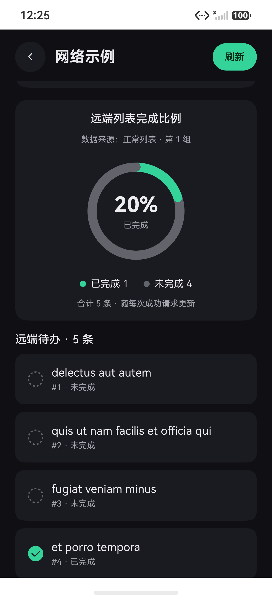

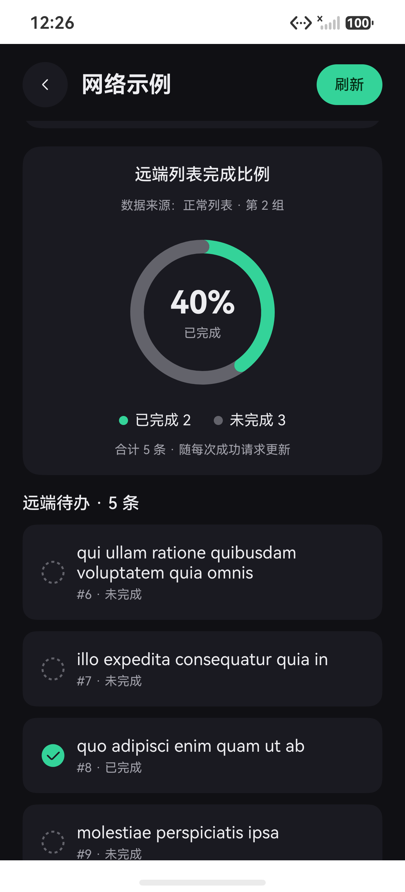

图5 改版前两组真实远端样本的完成比例

Fig. 5 Completion ratios of two remote sample groups before the update

图5左侧共5条，完成1条、未完成4条，圆环20%；右侧完成2条、未完成3条，圆环40%，分别符合1÷5与2÷5。数值由NetworkStore派生，换组重新请求接口，个人待办独立保存。图中大圆环与旧“网络示例”标题属于改版前布局；新版改为紧凑横排统计，尚待补拍。图示20%与40%是留存响应值，不视为所有请求的固定结果。

成功空数组替换当前结果并隐藏圆环；请求失败保留最近成功列表与图表，普通页面提示“上次加载的结果”，技术错误仅在展开设置后显示。两种状态均提供“重新加载示例”返回正常列表。图6左侧采于2026年11月27日改版前，右侧为11月26日404历史图，仅用于解释原有数据保留行为，不能替代新版恢复按钮的运行验证。

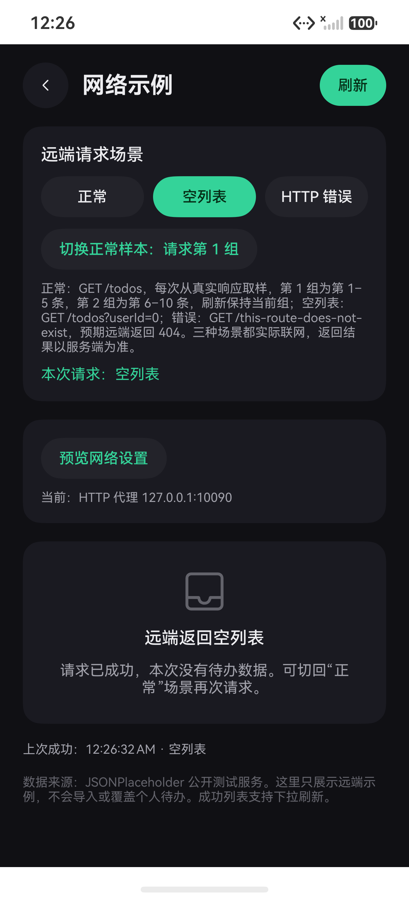

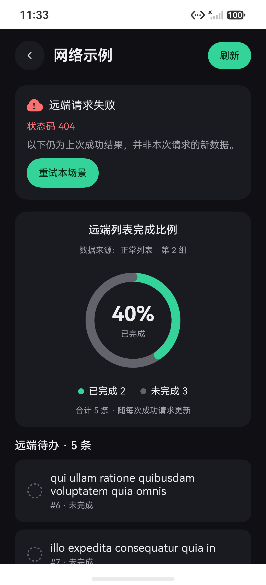

图6 改版前空列表与404保留旧数据画面

Fig. 6 Empty results and preserved data after an HTTP 404 before the update

图6旧画面中的“远端返回空列表”“本次没有待办数据”和HTTP 404保留原时点。新版空态改为“暂时没有示例任务”，普通失败不直接展示技术错误，并可重新加载正常示例；展开设置才显示“重试此演示”。本次29项网络检查覆盖新增的设置显隐、普通恢复及在途请求衔接，属于AST构建树与事件回调检查；新版正常、设置、空态、失败和恢复画面仍待实际采集。

### DeepSeek智能规划页面详细设计

#### 密钥配置与输入边界

智能规划以学习目标为输入，帮助用户把较大的课程任务拆成可执行事项。密钥输入框采用密码显示，可在本次会话中配置或清除，页面仅提示配置状态；API Key不写入Preferences、导出JSON、源码和日志，退出进程后需重新配置。请求只发送用户在当前页面主动填写的目标，不会自动读取或上传个人待办、描述和历史数据。固定官方HTTPS地址避免把密钥发送到任意输入的服务器。

用户确认发起请求后，服务层以POST访问https://api.deepseek.com/chat/completions，在Authorization请求头中携带Bearer密钥，使用deepseek-flash模型，关闭思考与流式输出，声明json_object响应格式。输入目标为空、密钥未配置或正在请求时不重复发起生成；网络超时、鉴权失败、额度不足、限流和异常响应分别给出可读提示，并在请求结束后释放HTTP对象。服务端返回内容经过JSON和字段校验后形成建议列表。

#### 结果预览、确认加入与离线演示

建议列表是待确认草稿，展示各项标题、描述与优先级。用户检查内容后点击加入，才调用TodoStore执行批量校验与统一保存，不让生成结果直接覆盖现有任务。加入成功后给出反馈并更新个人列表，重复操作受到状态约束。若保存失败则保留草稿，用户可修正或重试。未持有API Key时，页面提供清楚标注的离线示例，用于演示输入、建议预览和确认加入；该路径不发网络请求，也不计为DeepSeek调用成功。

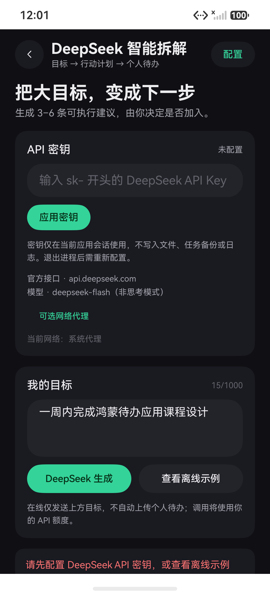

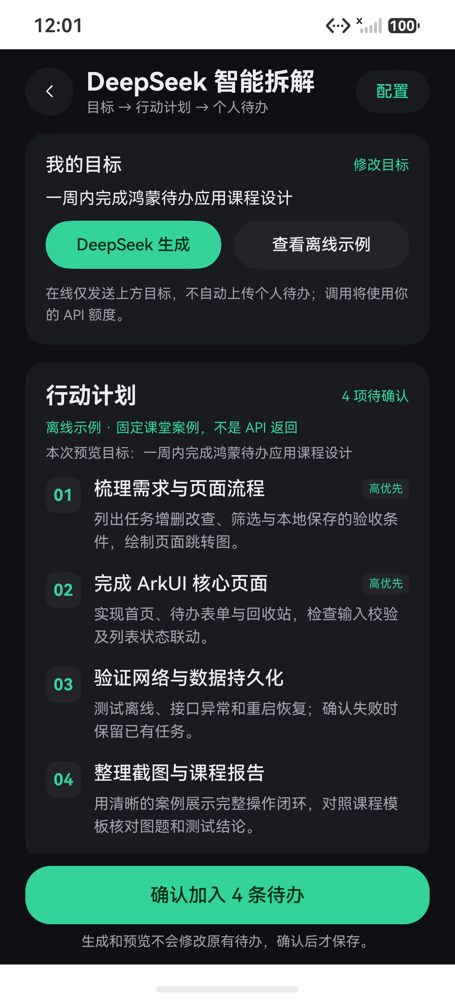

图7 会话密钥验证与离线规划示例

Fig. 7 Session-key validation and offline planning example

图7左侧为未配置会话密钥时的请求提示，右侧为四条离线课程建议，页面明确标注“离线示例”“固定课堂案例，不是API返回”。离线案例用于演示草稿预览与确认流程，不计为在线生成。另行留存的API来源预览、确认和加入反馈使用另一组任务标题；其证据范围在第5.4节说明。

## 系统实现

### 组件与页面实现

入口Index持有NavPathStack，以Navigation承载首页，并通过pageMap注册新增/编辑、示例任务和DeepSeek智能规划目标页。首页分别调用pushPathByName进入相应NavDestination；编辑页读取任务参数并在成功保存后pop返回。TodoItem通过@Param接收记录，通过@Event抛出完成、编辑和删除事件。智能规划先在独立页面维护建议草稿，确认加入时才调用个人仓库，保持页面跳转与数据提交的职责清晰。

### HTTP请求与响应式更新

ApiService创建HTTP请求对象，设置GET、连接与读取超时、系统或会话代理，并禁用缓存。响应码不为200、JSON无法解析或字段类型不符合约定时抛出异常；finally中调用destroy释放请求资源。NetworkStore入口先校验场景和分组，非法参数不改变有效选择；请求期间合并重复调用，避免并发切换改写当前请求。成功后替换items并记录成功时间和来源组；失败时保留原列表及图表。NetworkPage读取这些可观察状态，因此列表、空态、错误文案和圆环随请求结果变化，个人仓库不被网络页读取或修改。

### 测试与验证结果

2026年11月27日报告同步时重新运行scripts/verify.ps1，116项检查全部通过，退出码0，assembleHap显示BUILD SUCCESSFUL。日志为docs/evidence/report-sync-verification-2026-11-27.txt；此前112项定稿日志保留历史含义。网络检查从25项增至29项，新增首屏、设置显隐、正常恢复及在途演示请求结束后的恢复检查。本地脚本读取真实ArkTS源码，以SDK转译器与可控服务检查逻辑，不替代设备UI或真实远端。构建为使用缓存的增量构建，因未配置signingConfigs而跳过签名。表3列数量，表4列验证范围。

表3 本地回归检查结果

Table 3 Local regression checks

| 检查范围 | 数量 | 本次结果与主要覆盖 |
| --- | --- | --- |
| 待办仓库 | 38 | 通过；校验、保存、排序、回收站、导入与异常恢复 |
| 卡片服务 | 6 | 通过；卡片快照、读盘和推送逻辑替身检查 |
| 页面逻辑 | 8 | 通过；表单保存、导航及参数相关检查 |
| 日期逻辑 | 1 | 通过；1个汇总检查，内部含5组日期断言 |
| 状态响应式 | 6 | 通过；单例及统计依赖更新 |
| 网络逻辑 | 29 | 通过；响应校验、分组、容错及4项新增交互检查 |
| 组件样式与手势 | 4 | 通过；组件样式和交互约束检查 |
| DeepSeek逻辑 | 24 | 通过；解析、错误、草稿与整批导入 |
| 合计 | 116 | 退出码0；全部为本地逻辑检查，非设备端UI测试 |

表3数量采用统一脚本口径：日期脚本内部5组断言只计为1个汇总检查。工程原生Hypium目录仍含模板断言，不能将其另计为业务回归；有效业务检查位于scripts目录。

表4 主要场景与验证范围

Table 4 Scenarios and verification scope

| 核对场景 | 预期行为 | 证据与结论 |
| --- | --- | --- |
| 任务新增与修改 | 空标题拦截；有效修改统一保存 | 仓库、页面脚本通过；表单留存内容与首页对应 |
| 完成与筛选 | 计数、进度和可见任务一致 | 首页留存4/2/2、进度2/4；响应式脚本通过 |
| 删除与恢复 | 软删除入回收站，恢复可见 | 仓库脚本通过；历史交互记录保留原时点 |
| 网络双组 | 5条中完成1条或2条，显示20%或40% | 旧图数值一致；新版逻辑通过，布局待采图 |
| 空列表 | 显示空提示，隐藏图表 | 旧空态留存；新版恢复逻辑通过 |
| 404与失败保留 | 错误提示保留旧成功数据及来源 | 历史404保留数据；新版重试逻辑通过 |
| 规划草稿与导入 | 先预览和确认，成功后防重复加入 | 离线及API来源留存分开记录；本地检查通过 |
| 真实在线与设备扩展 | 真实鉴权、重启恢复及宿主行为另验 | 本次未独立复验，不列为已通过 |

留存首页计数为4/2/2，进度2/4；已完成筛选有两个任务，表单标题、重要标记与截止时间可对应。离线案例与API来源界面分开记录，避免混写为同一操作链。本次更新检查源码、既有PNG和同名JSON，并重新运行本地检查与构建；没有重新驱动模拟器采图。首页旧入口与网络旧布局均按改版前状态保留。

网络双组留存画面为1/5、20%和2/5、40%，旧空态无圆环，404使用注明日期的历史图。新增4项网络检查通过AST构建树、事件回调及仓库替身验证设置显隐和恢复行为，不属于设备UI像素或点击命中验收。当前HDC无连接设备，本次未接管IDE预览图像通道；新版运行截图尚缺。既有画面只覆盖采集时的模拟器屏幅。

### DeepSeek接入与验证

DeepSeekService负责密钥与目标校验、HTTP请求构造、状态码映射和响应解析。请求固定使用官方HTTPS接口与deepseek-flash模型，以json_object声明响应格式，系统消息给出JSON示例并限制为3–6条任务；仅接受完整结束的响应，对标题、描述、优先级及重复标题逐项校验。DeepSeekStore维护进程内密钥、生成状态和待确认草稿，合并重复请求，失败保留已有草稿；确认后复用TodoStore.importJson整批校验并统一保存，成功后阻止对同一草稿重复加入。页面不显示原始服务异常或响应正文，避免把密钥或非预期内容带入提示。

本次没有重新使用有效API Key调用DeepSeek，真实鉴权和在线成功响应未列为本次通过项。留存的submission-ai-online、submission-ai-confirm、submission-ai-added分别显示API来源预览、二次确认和“已加入4条待办”反馈，任务为“需求分析、核心页面、网络验证、报告整理”，与图7的离线固定案例区分。24项本地检查验证请求构造、解析、异常提示、并发约束和批量保存；真实在线路径仍需有效密钥与独立请求响应证据。

## 结论

本项目以ArkUI、状态管理V2与Navigation实现任务维护、页面跳转及响应式更新；个人仓库统一校验保存，示例任务页用DataPanel展示远端完成比例，DeepSeek以预览和确认衔接个人待办。2026年11月27日补齐折叠演示设置、紧凑统计与正常恢复流程，116项本地检查及增量构建通过。正文已同步新版，留存图按改版前时点解释，新版视觉验收待完成。

截止时间尚不发送通知，账号与云同步可后续扩展。新版示例任务页的正常、设置、空态、失败及恢复画面待补拍；多屏幅、真机、Preferences重启恢复、剪贴板授权、卡片宿主与DeepSeek真实在线成功路径仍需专项验收。

## 参考文献

[1] 华为开发者联盟. ArkUI概述[EB/OL]. https://developer.huawei.com/consumer/cn/doc/harmonyos-guides/arkui-overview（访问日期：2026-11-26）.

[2] 华为开发者联盟. 状态管理V2概述[EB/OL]. https://developer.huawei.com/consumer/cn/doc/harmonyos-guides/arkts-state-management-overview-V2（访问日期：2026-11-26）.

[3] 华为开发者联盟. Navigation导航[EB/OL]. https://developer.huawei.com/consumer/cn/doc/harmonyos-guides/arkts-navigation-navigation（访问日期：2026-11-26）.

[4] 华为开发者联盟. HTTP API参考[EB/OL]. https://developer.huawei.com/consumer/cn/doc/harmonyos-references-V5/js-apis-http（访问日期：2026-11-26）.

[5] JSONPlaceholder. Guide: Todos[EB/OL]. https://jsonplaceholder.typicode.com/guide/（访问日期：2026-11-26）.

[6] DeepSeek. API文档与首次调用[EB/OL]. https://api-docs.deepseek.com/（访问日期：2026-11-26）.

[7] DeepSeek. JSON Output[EB/OL]. https://api-docs.deepseek.com/guides/json_mode（访问日期：2026-11-26）.

## 附件

图8保留较早的Gitk历史快照，画面记录截至1c03dbf的四条提交；表5列出当前六条真实记录，HEAD为3d8e66b。项目历史始于2026年11月26日保存的既有工程基线，不能替代此前缺失的开发过程。本次报告整理及DeepSeek相关源码仍有未提交改动，不将它们写成已有提交，也不改写作者和日期。

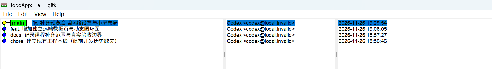

图8 既有项目Gitk提交历史快照

Fig. 8 Existing Gitk commit history snapshot

表5 当前可核验的Git提交

Table 5 Verifiable Git commits

| 提交 | 时间（北京时间） | 提交内容 |
| --- | --- | --- |
| 3ee526b | 2026-11-26 18:56:46 | 保存现有工程基线，注明此前开发历史缺失 |
| 176af14 | 2026-11-26 18:57:27 | 记录本轮课程补齐计划与验收范围 |
| 4f59075 | 2026-11-26 19:08:05 | 增加独立远端数据页与动态圆环图 |
| 1c03dbf | 2026-11-26 19:29:54 | 补充预览会话网络设置与小屏布局 |
| a3533f3 | 2026-11-26 22:27:07 | 修复首页筛选计数在任务变更后不更新 |
| 3d8e66b | 2026-11-26 22:27:07 | 支持远端真实样本切组与图表动态演示 |

图8由Gitk读取真实项目提交对象生成，保留其原有时点，不代表尚未提交的DeepSeek与报告定稿改动。项目未配置公开远端；当前材料不将公开托管自行列为课程必交项。选题登记和课程学期由本人核实，教师评阅、成绩及签名栏保留空白。
